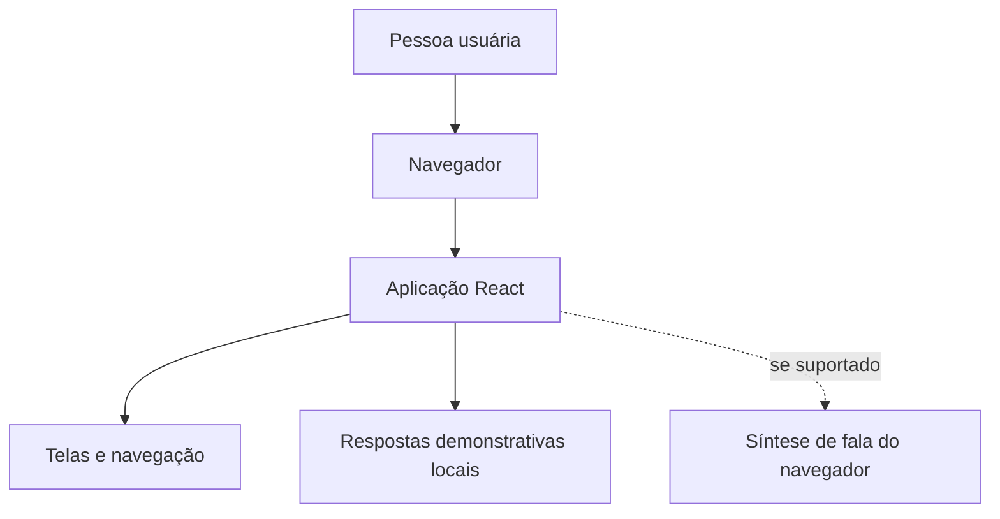

# Arquitetura e limites técnicos — ConectaIA

## 1. Visão arquitetural

A versão reconstruída é uma aplicação web de front-end. React compõe a interface; TypeScript descreve tipos e estrutura do código; Vite fornece ambiente de desenvolvimento e build. A conversa usa respostas demonstrativas locais. A leitura em voz alta pode usar a API de síntese de fala do navegador.

## 2. Componentes e responsabilidades

| Componente | Responsabilidade | Situação |
|---|---|---|
| Navegador | Executar a aplicação e renderizar a interface | Ambiente de execução |
| React | Construir a interface e atualizar a visualização | Tecnologia do projeto |
| TypeScript | Tipagem estática durante desenvolvimento/build | Tecnologia do projeto |
| Vite | Servidor de desenvolvimento e empacotamento | Tecnologia do projeto |
| Respostas demonstrativas | Mostrar respostas de exemplo no chat | Não é modelo de IA |
| Síntese de fala do navegador | Tentar ler conteúdo em voz alta | Depende do navegador |
| Backend próprio | Processar solicitações no servidor | Não incluído/confirmado |
| Banco de dados | Persistir perfil, preferências ou conversas | Não incluído/confirmado |
| Provedor externo de IA | Gerar respostas com modelo de linguagem | Não conectado |

## 3. Diagrama

## 4. Decisões e justificativas

- **Aplicação web:** permite demonstrar o fluxo em um navegador sem instalação de aplicativo nativo.
- **React:** organiza a interface em componentes reutilizáveis.
- **TypeScript:** ajuda a detectar alguns erros de tipo durante o desenvolvimento.
- **Vite:** oferece servidor de desenvolvimento e build.
- **Respostas locais:** adequadas para simular o fluxo em um protótipo, mas insuficientes para alegar inteligência conversacional real.
- **Síntese do navegador:** pode oferecer leitura em voz alta sem serviço externo, mas o suporte varia por ambiente.

Estas justificativas descrevem a adequação técnica do protótipo; não são resultados de avaliação com usuários.

## 5. Segurança, privacidade e disponibilidade

Como não há backend ou persistência confirmados, não se deve afirmar que existem contas seguras, criptografia de dados armazenados ou histórico salvo. A demonstração deve usar exemplos não sensíveis. Não se deve inserir chaves secretas no código front-end. Se uma API real for incorporada futuramente, a arquitetura deve incluir backend/proxy seguro, gestão de credenciais, tratamento de erros, limites de uso e política de privacidade.

## 6. Evolução futura, se autorizada pelo escopo acadêmico

1. Definir requisitos de integração com IA.
2. Escolher serviço e documentar custos, limitações e tratamento de dados.
3. Projetar uma camada de servidor para não expor chaves no navegador.
4. Definir política de retenção e exclusão antes de armazenar conversas.
5. Criar testes de integração e de falhas.
6. Avaliar a experiência com usuários de forma ética e documentada.
7. Atualizar diagramas, requisitos e plano de testes.

Nenhum item desta seção deve ser apresentado como implementado.
