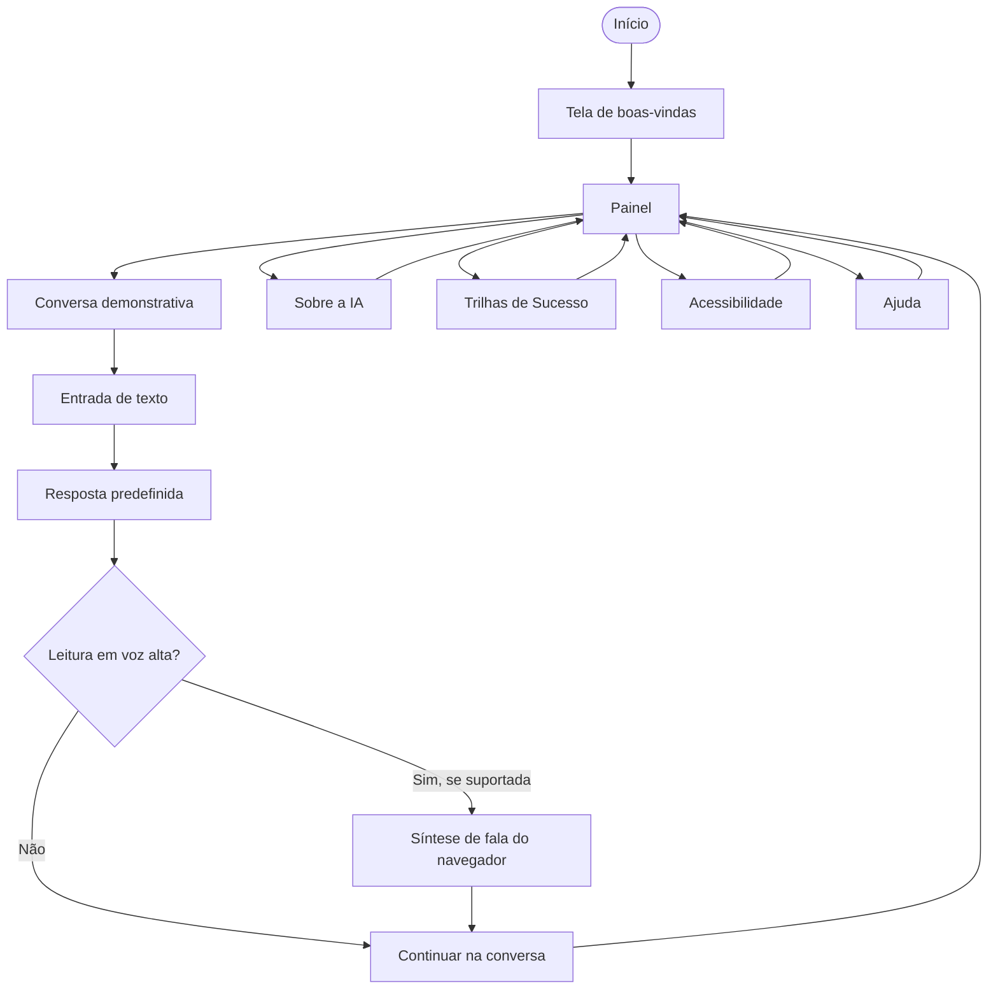
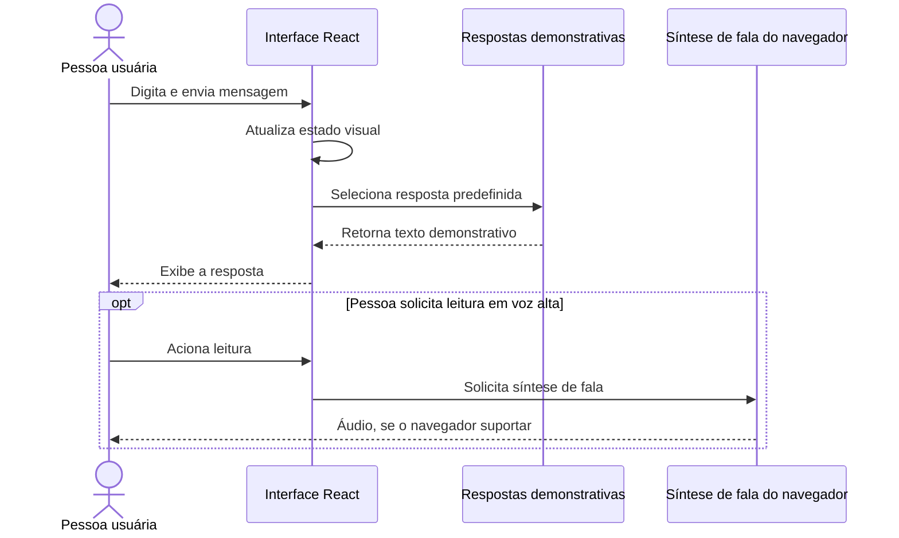
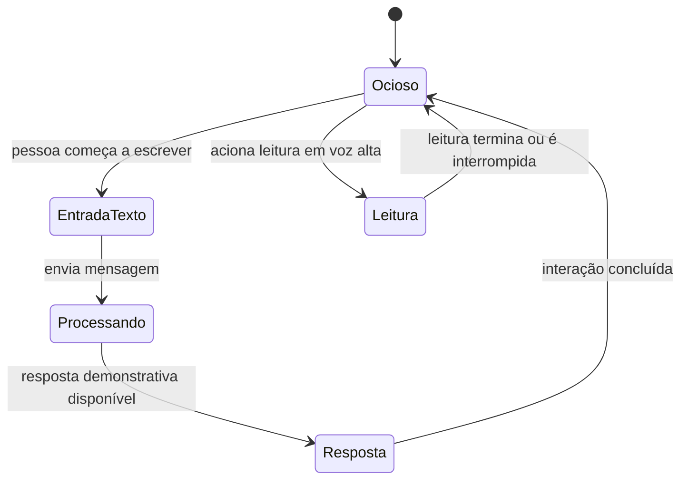
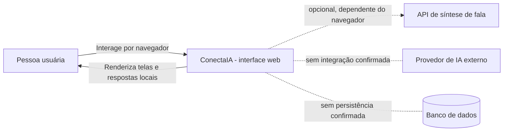

# Fluxos e diagramas — ConectaIA

Os diagramas abaixo são representações textuais editáveis em Mermaid. Revise-os conforme o comportamento efetivo do código.

## 1. Navegação de alto nível

## 2. Sequência da conversa simulada

Este diagrama não representa uma chamada a um modelo de linguagem. A seleção da resposta demonstrativa é local ao protótipo.

## 3. Máquina de estados conceitual

“EntradaTexto” é uma alternativa de interação textual. Um estado visual chamado “Ouvindo” não deve ser interpretado como reconhecimento de voz real sem implementação e teste específicos.

## 4. Diagrama de contexto

Linhas pontilhadas indicam integração não implementada/confirmada, não uma dependência ativa.

## 5. Modelo de dados

A versão documentada não confirma banco de dados nem persistência. Portanto, não se define um esquema de entidades persistentes como se existisse. Se futuramente forem armazenados perfil, preferências ou histórico, será necessário especificar finalidade, campos, retenção, acesso, consentimento/base legal aplicável e mecanismos de proteção antes da implementação.

## 6. Fluxos alternativos e falhas

- **F1 — Navegador sem síntese de fala:** a pessoa continua usando o conteúdo visual; a limitação deve ser comunicada.
- **F2 — Mensagem sem texto:** impedir envio vazio ou fornecer orientação clara, conforme o comportamento implementado.
- **F3 — Resposta demonstrativa não corresponde à pergunta:** não apresentar a resposta como inteligência contextual real; explicar a natureza da simulação.
- **F4 — Controle de acessibilidade sem efeito:** registrar defeito, corrigir rótulo/comportamento e repetir o teste.
- **F5 — Falha ao iniciar aplicação:** registrar comando, erro completo e versões do ambiente.
- **F6 — Ajuda interpretada como emergência:** deixar explícito que a área é informativa e não aciona socorro real.

## 7. Observação para avaliação

A existência destes diagramas não comprova usabilidade, acessibilidade ou correção. Eles são artefatos de modelagem para orientar implementação, revisão e testes.
